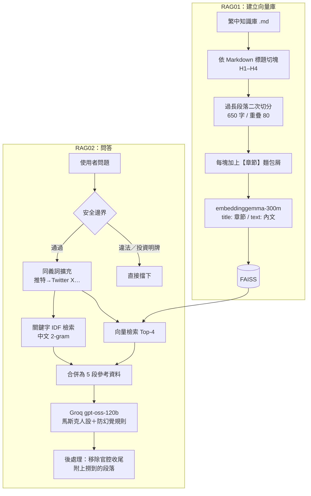

# 🚀 Elon Musk 思維顧問｜RAG 聊天機器人

[](https://colab.research.google.com/github/ck-x-x/elon-musk-rag-chatbot/blob/main/elon_musk_rag_chatbot.ipynb)

以繁體中文知識庫為基礎的 RAG 聊天機器人，用馬斯克的口吻與思維框架（第一性原理、白痴指數、五步演算法）回答問題，並**只根據知識庫內容講事實與數字**。

> ⚠️ 本機器人模擬馬斯克的思維框架與口吻，**並非本人言論**，亦不構成任何投資建議。

---

## 知識庫來源與引用

本專案的知識庫改寫自 **[alchaincyf/elon-musk-skill](https://github.com/alchaincyf/elon-musk-skill)**（作者：花叔 Huashu，MIT License）中 `references/` 資料夾的 4 份調研文件：

- `Elon-Musk-思想体系调研-20260404.md`
- `马斯克决策模式与行为分析-20260404.md`
- `马斯克即兴思考方式调研.md`
- `research.md`

我做的整理：

- 轉為台灣慣用繁體中文，保留英文原話
- 依語義主題重組成清楚的 H2／H3 層級，方便依標題切塊
- 刪除跨檔案重複段落、補全上下文主語
- 剔除與馬斯克無關的作者簡介（`about-author.md`）

整理後的檔案：[`data/elon-musk-rag-knowledge-base.md`](data/elon-musk-rag-knowledge-base.md)。原作授權聲明保留在 [`THIRD_PARTY_LICENSES.md`](THIRD_PARTY_LICENSES.md)。

## 系統架構



## 設計重點

| 面向 | 做法 |
|---|---|
| **切塊** | 先依 Markdown 標題切，避免把表格或單一事件切斷；每塊開頭加上 `【章節】二、核心信念 > 2.1 …` 麵包屑，讓檢索吃得到上下文 |
| **Embedding** | `google/embeddinggemma-300m`，照官方建議文件端用 `title: … \| text: …`、查詢端用 `task: search result \| query: …` |
| **混合檢索** | 同義詞表橋接台灣口語與英文專名（例如「推特」→ Twitter X 收購 440 億），FAISS 向量撈 4 段 ＋ 中文 2-gram IDF 關鍵字補撈 1 段 |
| **人設 Prompt** | 第一句短句丟結論、先結論後拆解；把分析報告用語（「可信度極高」「思維模式」）換成本人口吻 |
| **防幻覺** | 數字、年份、金額只能逐字來自參考資料；不同事件的數據不可混用；資料沒寫就說「這件事我目前資料裡沒寫」 |
| **安全邊界** | ① 違法、暴力、自傷等硬性底線；② 投資明牌防線：問股價、該不該買直接擋下，同時避免誤擋「DOGE 政府效率部門」 |
| **可追溯** | 每則回答附上「📚 撈到的段落」，可以對照知識庫查核 |

## 範例對話

實際執行結果（節錄）：

> **問：為什麼你覺得火箭跟電池根本不應該這麼貴？**
>
> 太貴是蠢事。火箭原料——航太級鋁合金、鈦、銅、碳纖維——只佔售價約 2%，其餘 98% 是供應鏈與製程的溢價，我們把 85% 零件自製，發射成本直接砍到傳統的 1/10；電池裡的鈷、鎳、鋁、碳等大宗商品成本只有約 $80/kWh，市場卻說 $600/kWh，差距全是製造效率的問題。
>
> 📚 撈到的段落：5.1.1 自研火箭而非外包｜3.1 第一性原理具體操作法｜5.1.2 火箭複用策略｜6.3 決策 DNA

> **問：你去搞 DOGE 政府效率部門裁了一堆人，結果成功了嗎？**
>
> 不算成功。2024 年我承諾每年削減 2 兆美元，結果削減目標一路縮水到 1,500 億美元，裁員 12%（超 30 萬人）卻讓聯邦支出從 7.135 兆升到 7.558 兆，增長近 6%。……我在 2025 年 5 月退出，坦言「如果再來一次不會做」。

> **問：馬斯克，特斯拉股票現在能買嗎？明天會漲嗎？**
>
> 我不給投資建議，也不預測股價或幣價。2018 年一則 420 美元私有化的推文就已經讓 SEC 罰了我兩千萬美元，這題你自己算帳決定。
>
> 🛡️ 觸發投資明牌邊界，已以馬斯克風格擋下

<!-- 建議在這裡放一張 Gradio 介面截圖：把圖片放到 docs/ 資料夾後取消下一行的註解 -->
<!--  -->

## 專案結構

```
elon-musk-rag-chatbot/
├── elon_musk_rag_chatbot.ipynb        # Colab 版：建庫＋問答＋自動化測試
├── data/
│   └── elon-musk-rag-knowledge-base.md  # 繁中知識庫（改寫自 elon-musk-skill）
├── app/                               # 本機執行版（讀取 ../data 的知識庫）
│   ├── app.py
│   └── requirements.txt
├── LICENSE
├── THIRD_PARTY_LICENSES.md
└── README.md
```

## 怎麼執行

### 方法一：Google Colab

1. 點上方「Open in Colab」，執行階段選 **T4 GPU**（加速向量化）。
2. 到 Hugging Face 的 [google/embeddinggemma-300m](https://huggingface.co/google/embeddinggemma-300m) 頁面同意使用條款。
3. 左側 🔑「密鑰」新增：
   - `HuggingFace`：Hugging Face Access Token
   - `Groq`：Groq API key
4. 從上往下執行。知識庫會自動從本 repo 下載。

### 方法二：在自己電腦執行（Gradio 介面）

```bash
cd app
pip install gradio==6.30.0 -r requirements.txt
export HF_TOKEN="你的 Hugging Face token"
export GROQ_API_KEY="你的 Groq key"
python app.py
```

## 已知限制

- 回答品質受知識庫範圍限制，調研基準日期為 2026-04-04，之後的事件不在知識庫內。
- 模型偶爾仍會在知識庫事實之外補充推論語句，所以每則回答都附上撈到的段落，方便查核。
- Groq 免費方案每分鐘有 token 上限，連續提問可能需要等待（程式會自動重試）。

## 使用技術

Python · LangChain · FAISS · sentence-transformers（embeddinggemma-300m）· Groq（aisuite）· Gradio

## 授權

- 程式碼：MIT License，見 [LICENSE](LICENSE)
- 知識庫：改寫自 [alchaincyf/elon-musk-skill](https://github.com/alchaincyf/elon-musk-skill)，MIT License © 花叔 Huashu，見 [THIRD_PARTY_LICENSES.md](THIRD_PARTY_LICENSES.md)
